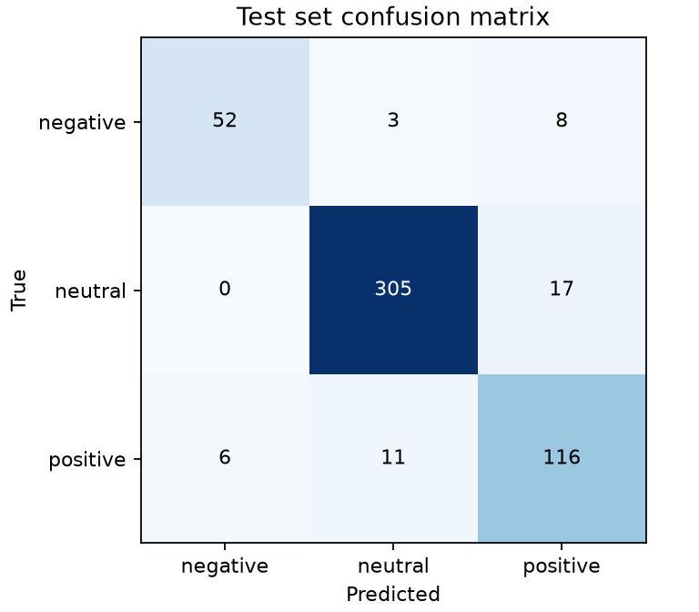

# Financial Sentiment Classifier: fine-tuning DistilBERT

A Python desktop app that fine-tunes a **DistilBERT** transformer on any labelled CSV and classifies new text as negative, neutral or positive, with a probability chart. The model is evaluated on an expert-labelled benchmark with a held-out test set.

## Results

Trained on the [Financial PhraseBank](data/README.md): 3,448 distinct financial-news sentences labelled by finance experts. The split is 70% train, 15% validation (to choose the epoch) and 15% test (used once, at the end).

| Held-out test set (518 sentences) | Score |
|---|---|
| Accuracy | **91.3%** |
| Macro-F1 (each class weighted equally) | **0.886** |
| Baseline: always predict "neutral" | 62.2% |

| Class | Test accuracy |
|---|---|
| Neutral (62% of data) | 94.7% (305/322) |
| Positive (26% of data) | 87.2% (116/133) |
| Negative (12% of data) | 82.5% (52/63) |



The commonest mistake is reading a neutral sentence as positive (17 of 322). Full per-epoch metrics are in [`results/metrics.json`](results/metrics.json). The run takes about 5 minutes on an Apple M1.

## Design choices

- **No leakage between sets.** Duplicate sentences (ignoring case and spacing) are removed before splitting, and sentences with conflicting labels are dropped. If the same sentence appeared in training and validation, validation accuracy would measure memorisation, not understanding. The app also refuses data with too few distinct sentences per label.
- **A held-out test set.** The test set is never used for decisions: validation picks the epoch, and the test set is scored once. Macro-F1 and a confusion matrix are reported alongside accuracy, because with imbalanced classes accuracy alone can hide a weak rare class.
- **Imbalanced classes.** Class weights come from the training split only, so the loss does not reward always predicting "neutral". The best epoch is chosen by validation macro-F1.
- **Reproducible and fast.** Seeds are fixed; batches are padded only to their longest sentence; training runs on an Apple-silicon or NVIDIA GPU when one is available.
- **Responsive app.** Training runs on a background thread, the buttons lock until it finishes, validation results are shown in the GUI, and the chart uses the labels from your CSV.

## How it works

1. **Data collection** (`data_collection.py`): load the CSV, clean it, make a stratified split.
2. **Model training** (`model_training.py`, `models.py`): DistilBERT, then the [CLS] representation, dropout and a linear layer. Trained with class-weighted cross-entropy, AdamW (learning rate 2e-5) and gradient clipping, for 3 epochs.
3. **Model validation** (`model_validation.py`): accuracy, per-class accuracy, macro-F1 and the confusion matrix after every epoch.
4. **Prediction** (`prediction.py`): softmax probabilities for each label.
5. **Dashboard** (`dashboard.py`): a Tkinter GUI that trains on a background thread and shows a Matplotlib chart.

## Running it

Python 3.12+.

```sh
python -m venv .venv && source .venv/bin/activate
pip install -r requirements.txt
python main.py                       # the app: browse to data/financial_phrasebank_75agree.csv, then Train
python -m scripts.evaluate           # reproduce the results above (writes results/)
python -m unittest discover -v       # 14 tests, under 2 seconds, no model download
```

The first run downloads DistilBERT (about 260 MB). The app trains on any CSV with a text column and a label column. Set the column names in the GUI.

## Repository layout

```
financial_sentiment_classifier/   the five components (data collection, training, validation, prediction, dashboard)
scripts/                          prepare_data.py (builds the dataset CSV), evaluate.py (train + test report)
data/                             Financial PhraseBank CSV and its licence notes
results/                          metrics.json and the confusion matrix from the run above
tests/                            unit tests using a tiny model, so they run without a GPU or downloads
main.py                           launches the app
```

## Limitations

- **One domain.** The labels reflect an investor's view of financial news, so performance on, say, product reviews is untested.
- **The 75%-agreement subset.** These sentences are clearer than the full dataset, which makes the task easier than with all sentences.
- **One run.** Results come from a single seed and split; the spread across seeds is not measured.
- **Comparison.** The only baseline is the majority class; a simpler model (e.g. TF-IDF with logistic regression) is not compared.
- **No saved model.** The app retrains each session; a trained model is not saved between sessions.

Dataset: Malo et al. (2014), CC BY-NC-SA 3.0. See [data/README.md](data/README.md).
